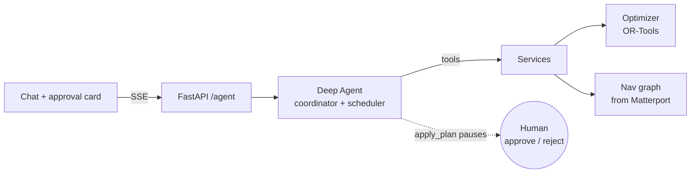

# Rounds

> **The smarter way through every shift.**

Rounds plans and replans the shift for hospital staff who cover the whole building: transporters, respiratory therapists and IV team nurses. It builds a navigation graph from a building's Matterport digital twin, orders the work with a deterministic optimizer, and puts an AI agent in charge of coordinating. **A human approves every schedule change.**

Built at HackPrinceton 2026. Status: **early build.** The backend and a first frontend work and are tested.

---

## How it works



1. **A request comes in.** It is either a chat message ("what's on the unit?") or a dispatch event such as "new job J-17".
2. **The agent plans it.** It writes a todo list and hands scheduling to a `scheduler` subagent, which asks the optimizer for a proposal.
3. **The agent pauses.** Applying a plan always stops for a human, and the approval card shows the plan diff computed by the optimizer.
4. **The human decides.** Approve applies the plan once. Reject applies nothing, and the agent replies.

Everything streams to the client as typed Server-Sent Events: `todos`, `tool_call`, `approval_required`, `done` and so on.

## Ground rules

- **The LLM coordinates; code does the math.** Routes, distances, ETAs and orderings come only from the optimizer and pathfinding, never from the model.
- **No clinical decisions.** Priorities come from the input data.
- **Never silently drop a job.** Infeasible jobs are flagged with a reason.
- **Synthetic data only.** No real patients, and the model only sees IDs.

## What's built

| Piece | Where | Status |
|---|---|---|
| Nav graph from a Matterport export (A*, named places) | `backend/app/spatial/` | ✅ |
| Optimizer + baseline metrics (OR-Tools) | `backend/app/optimization/` | ✅ |
| Seeded synthetic staff and jobs | `backend/app/synthetic/` | ✅ |
| Deep Agent: coordinator, scheduler, approval gate | `backend/app/agents/`, `backend/app/tools/` | ✅ |
| Agent API (SSE chat, dispatch inbox, approvals, state) | `backend/app/api/agent.py` | ✅ |
| Shared models and service contract | `backend/app/models/`, `backend/app/services/contract.py` | v0, provisional |
| Real services that connect the optimizer to the agent | `backend/app/services/` | ✅ |
| Main app + domain API (places, map, staff, jobs, plans, routes, clock) | `backend/app/main.py`, `backend/app/api/rounds.py` | ✅ |
| Frontend: floor plan, plan view, approval card, dispatch, agent chat, 3D tour (React + Vite) | `frontend/` | ✅ |

## Quick start

You need Python 3.11+ and [uv](https://docs.astral.sh/uv/).

```bash
cd backend
uv sync --group dev
uv run --group dev pytest          # offline: no API key, no network
```

To run the app locally (domain API at `/api`, agent API at `/agent`, interactive docs at `/docs`):

```bash
uv run uvicorn app.main:app --reload --port 8000
curl -s localhost:8000/api/meta                   # scenario (SYNTHETIC), clock, shift
curl -s -X POST localhost:8000/api/plans/propose  # optimizer proposal + diff + baseline
curl -s -X POST localhost:8000/agent/threads      # -> {"thread_id": "..."}
```

Then the frontend, in a second terminal (Node 20+):

```bash
cd frontend
npm install
npm run dev                                       # http://localhost:5173 (localhost, not 127.0.0.1)
```

Vite proxies `/api` and `/agent` to the backend on :8000.

The building export (`data/raw/matterport/6Ee2LwLfx58.json`, gitignored; see `docs/handoff-2026-11-15.md`) is loaded at startup. Without it, `/api` returns 503 and the agent still starts.

`backend/app/agents/README.md` has an example for every endpoint and the full event contract. To present the demo, follow `docs/demo-runbook.md`.

## Configuration

Secrets go in `local.env` at the repo root. It is gitignored. Copy `.env.example` to start.

| Variable | What it's for |
|---|---|
| `ANTHROPIC_API_KEY` | The agent's model. Without it, the agent returns a clear `model_unavailable` error and everything else keeps working. |
| `AGENT_MODEL` | Optional. Defaults to `anthropic:claude-haiku-5-5`. |
| `MATTERPORT_*` | Matterport Model API and Showcase SDK. Server-side only. |
| `COSTAR_DATA_DIR` | Your local copy of the CoStar kit. It stays outside the repo. |

## Tech

Python · FastAPI · React + Vite + Tailwind · LangChain [Deep Agents](https://docs.langchain.com/) · LangGraph · Claude Haiku 5.5 (Anthropic API) · OR-Tools · Pydantic · Matterport

## Repo map

```
backend/        FastAPI app, agent, optimizer, spatial, tests
frontend/       React + Vite UI
tools/          Matterport export tooling
docs/           design specs, plans, task split, handoffs
pitch.md        problem, users, and demo story
AGENTS.md       rules for humans and coding agents working on this repo
```

## Data and honesty

The building layout comes from a public Matterport tour, *Airedale Hospital AAU* by apollo3d. Raw exports are never committed. Staff, jobs and schedules are **synthetic** and labeled that way. Before/after numbers are computed on the same graph, from the same start and with the same job set, and are never hardcoded.

## Team

Minh: agent and agent API. Benjamin: optimizer, backend core, spatial, frontend.
